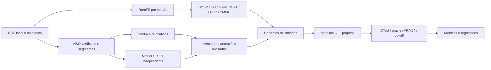

# Arquitetura da pesquisa

O trabalho separa o que vem do executável, o que vem dos formatos e o que foi implementado em C++.

`scripts/audit_inputs.py` verifica os containers. `inspect_nso.py` descomprime e confere os hashes de todos os segmentos. `nxo_metadata.py` lê MOD0, ELF, RELA/RELR e RTTI sem depender da nomenclatura do Ghidra. `VerifyRelativeRelocations.java` compara esses resultados ao banco importado.

`ExportResearchInventory.java` exporta funções, CFG, calls, strings, xrefs e externals para `private/outputs/<versão>/ghidra`. Descoberta automática e assinaturas não constituem revisão. `ImportValidatedSymbols.java` aplica somente a pequena lista versionada e adiciona um slice de parâmetros com dois offsets comprovados; não propaga assinaturas conjecturais.

Os catálogos de formatos e os dumps legíveis ficam privados. O `functions.csv` do EventFlow é gerado de arquivos da mesma versão, com tipos observados; conflitos e domínios de retorno não comprovados são explícitos. O fluxo do aeroporto recompilado mantém o grafo canônico e suas chamadas serializadas. A execução C++ usa interfaces para as queries/actions externas.

Os módulos de `reconstructed/` são independentes do runtime Switch: leitor BCSV com limites verificados, fluxo do aeroporto 1.0.0, retorno zero, Murmur3 sobre string C e predicado inteiro de flags. O leitor de flags e os serviços do fluxo são substitutos injetados. Renderer, mundo, inventário transacional e rede não foram reconstruídos.

`map_versions.py` gera hipóteses por instruções normalizadas, CFG, contexto de chamadas e identidade RTTI. `run_all.ps1` consolida validação e métricas. Elysium Crossing permanece fora deste grafo conforme o escopo acordado.
